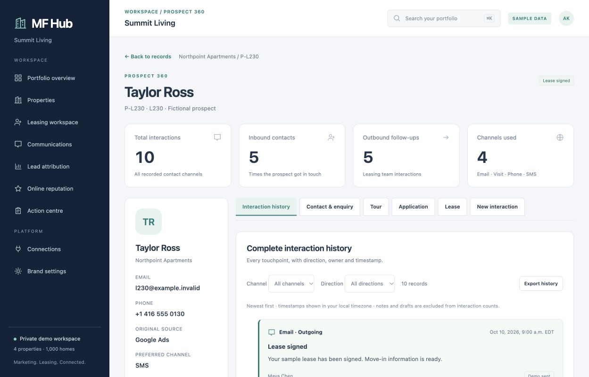

# MF Hub — Marketing & Leasing Intelligence

A private, interactive multifamily marketing and leasing prototype. The application uses HTML, CSS and ES modules, with a dependency-free Worker for property website content.

## Run and test

Run `npm run dev` and open http://localhost:4173. This builds and serves the Worker, including property website content. In the Sites environment, run `sites-preview start <checkout>`.

```sh
npm run check
npm test
```

The deployment configuration is `.openai/hosting.json`. Keep the existing project identity when updating the Site.

## Working repository

Source: https://github.com/atulyadk-stack/Multi-Family-Marketing-Leasing-Hub

Private demo: https://mf-hub-summit-v1.richalpaca1.chatgpt.site

GitHub is the working source for ongoing edits. Site publishing is a separate step; a GitHub push alone does not update the live demo.

## Included

- Executive portfolio overview and property drill-downs.
- Seven reputation views: overview, review inbox, performance, sentiment, listings, competitors, surveys.
- Seven attribution views: overview, sources and spend, conversion, website and paid, organic content, lead journeys, recommendations.
- Working property/company/city/month filters, search and CSV exports.
- Review assignment, editable sample reply and completed-response metrics.
- Clickable enquiry, scheduled-tour, completed-tour, application and lease counts in the portfolio and property views.
- Searchable, filterable prospect lists and CSV exports that reconcile with the cohort totals.
- Prospect 360: contact/enquiry details, repeated-contact counts, tours, application checklist and lease metadata.
- Unified inbound/outbound history across email, SMS, phone, web chat, WhatsApp and property visits, plus internal notes.
- Demo message composition, incoming-message simulation and call logging with duration/outcome. No actual messages or calls are sent.
- Tour booking with date/time/type and an automatic demo confirmation in the contact history.
- Responsive record cards, scrollable detail tabs, touch-sized controls and mobile navigation.
- Shared action centre with assignment and status changes.
- Customer name and accent-colour settings; one-click demo reset with a confirmation dialog.
- Connection planning cards. These do not connect to vendor services.

## Five-minute CEO walkthrough

1. Open Portfolio overview. Explain the four-property, 1,000-home fictional portfolio.
2. Select Northpoint Apartments. Its occupancy is 93%, lead-to-lease conversion is 4.4%, and 12 reviews await responses.
3. Open the review inbox. Open a review, assign an owner, use or edit the sample response, then complete it. The open count falls by one.
4. Open Lead attribution and clear the property filter. Compare ILS paid cost per lease ($900) with Google Ads ($1,286) and Meta ($3,600).
5. Open a source and a prospect record to inspect the milestone journey. Open the portfolio Enquiries card and a prospect without a scheduled tour. Use the Tour tab to book an appointment and see both the count and communication history update.
6. Create a follow-up task and change its owner/status in the Action Centre.
7. Change the customer name/accent in Brand settings. Reset the demo before the next presentation if desired.

## Data definitions

`dist/model.mjs` is the deterministic synthetic data and calculation layer. October has 240 unique enquiries, 100 scheduled tours, 72 completed tours, 32 applications and 18 leases. Paid sources account for 180 enquiries and 14 leases, against CAD 18,000 media spend. September is a distinct 228-enquiry sample cohort.

Original-source attribution gives each lease one source credit, assigned on first enquiry. Acquisition stages use creation cohorts with outcomes through November 13, 2026. Conversion is cohort leases divided by cohort enquiries. Velocity is the nearest-rank P75 of elapsed days among converted leads. It excludes unconverted prospects.

Paid cost per lease uses 14 paid-source leases; blended ad spend per lease uses all 18 leases. Organic/referral costs are unallocated, not zero. These are advertising metrics, not full acquisition costs.

October reviews total 240 with 1,000 stars: average 4.1667. 216 are answered, 24 open, and 9 marked overdue. A completed demo response updates the relevant month/property. Sentiment uses transparent sample rating buckets and topic assignments; no AI sentiment service is called.

Occupancy, listing health, competitors and survey results are fixed fictional snapshots. NPS uses a separate 240-response sample survey: 156 promoters, 60 passives, 24 detractors, for +55 NPS. It is not derived from review stars. Website/social metrics are illustrative period data; selected social examples do not sum to all period activity.

## Source and design context

The information architecture follows the user's supplied Birdeye reputation report and Halo/Hyly sample attribution report, interpreted into an original MF Hub interface. The app includes no confidential recordings, vendor screenshots, real resident records or original report files.

## Persistence and limits

This is a frontend prototype. Demo communications, prospect owners, tour details, responses, assignments, bookings, tasks and branding are stored in the current browser's localStorage. They are not synced across people or devices. Filters reset on reload. The reset control clears this app's own demo state only.

No messages are sent, reviews published, listings changed, campaign budgets modified or real calendar appointments booked. Draft replies and recommendations are templates/rules, not live AI calls. Connection cards are planning notes; API availability and white-label rights still require vendor confirmation.

The Site is owner-private. It is intended for the owner to present in a meeting. Customer access should be configured deliberately before sharing outside that account.

## Next implementation phase

Add an authenticated server, tenant-scoped records, durable storage, audit trails and vendor connectors behind the same data contracts. Confirm source mapping and commercial access with each provider, then pilot a small property set and reconcile results. Do not place credentials in client-side files.

## Verification

Fifteen automated tests cover portfolio/source reconciliation, cumulative cohort milestones and as-of dates, filter scopes, response updates, booking idempotency, task deduplication, CSV escaping and state defaults, every stage/property/cohort drill-down, repeated-contact counts, interaction validation, notes/draft exclusion, confirmation logging and communication persistence, and Worker asset/property API routing.

Desktop browser checks cover all 14 report views, property filtering, editable sample response completion, reassignment, saved-state reload, prospect-source drill-down, sample booking, task creation/status, branding persistence and reset. Responsive browser checks cover 320px and 390px widths, mobile navigation, prospect details, message composition and tour booking. These are browser viewport tests, not physical-device certification.

## Communication architecture

See [the production connection plan](docs/communications-production-plan.md) for the remaining backend, provider, identity, delivery-receipt and data-persistence work required for live operations.

## Local preview

Use `npm run dev` to preview both the dashboard and the property website service. A recent Node.js runtime is required for the checks and tests; the application has no runtime package dependencies.

## Property website content

The property dialog shows contact details from the portfolio record. For a live property, set `website` to its final official HTTPS listing URL in `dist/model.mjs`, set `demoWebsite` to false, and provide the verified address and direct leasing phone. The Worker fetches the configured listing HTML when needed and caches successful results for up to an hour per running instance. It reads structured property data, image tags and labeled feature lists. Pages that render their gallery only with client-side JavaScript may return partial results. Fictional demo records use sample listings and city-level directions.

## Prospect dashboard preview


